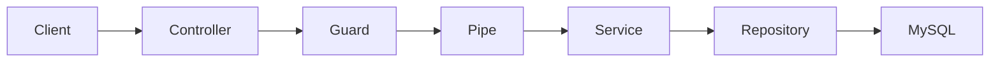

# Beginner Nest notes API

You type every file. The guide explains the idea first, then gives a short snippet. You run it and paste errors back. We stay on official Nest patterns: feature modules, dependency injection, DTOs, `ValidationPipe`, `ConfigModule`, TypeORM, guards, and migrations. One idea per step.

This repo is the learning app. A logged-in user keeps folders, and each folder holds notes. Relative imports keep the `.js` extension because this project uses ESM.

Tests are postponed. We are not writing them at this stage.

## What you will be able to do at the end

- Explain a request: route, controller, service, database, JSON response, status code.
- Register and log in, with passwords hashed and a JWT checked on protected routes.
- Create, list, update, and delete folders and notes, but only for the logged-in user.
- Reject bad input before it hits the database.
- Change the database with migrations, and load fake data with a seed.
- Read errors and fix them instead of copying a tutorial blindly.

## App shape



Three feature modules, same layout Nest docs use:

- `auth` — register, login, JWT
- `users` — current user profile
- `notes` — folders and notes

Two relations only: a user has many folders, a folder has many notes. That is enough to learn foreign keys. Tags, many-to-many, caching, queues, and microservices stay out.

## Lessons

We do not skip ahead. Each lesson ends with something you can hit in the browser or with a REST client.

1. **HTTP in plain language.** What GET, POST, PATCH, and DELETE mean, what JSON is, and what 200, 201, 400, 401, and 404 mean. No Nest yet beyond "a controller is a function that answers a URL."
2. **Nest skeleton.** `main.ts`, `AppModule`, a controller, a service, and why the module lists both. You return a hard-coded `{ ok: true }` so you see the loop: URL to method to JSON.
3. **Config.** `@nestjs/config` and a `.env` for port and database. No secrets in code. `.env` stays out of git.
4. **Database connection.** TypeORM + MySQL. `synchronize: false` from the start so you learn migrations instead of auto-updating the database.
5. **First entity and migration.** `User` (`id`, `email`, `password`, `name`, timestamps). You generate a migration, run it, and look at the table in MySQL so the entity and the table feel like the same thing.
6. **Seed.** One script that inserts a demo user. Seed data is not production data.
7. **DTOs and validation.** `class-validator` + global `ValidationPipe`. A bad email or a short password returns 400 before any service runs. `whitelist` so extra fields are dropped.
8. **Users service and repository.** Create a user from a DTO. Hash the password with `bcrypt`. Never return `password` in responses.
9. **CRUD by hand on folders.** Controller, service, entity, DTO, migration. List, get one, create, update, delete. This is the pattern you will repeat for notes.
10. **Relations.** `User` to `Folder` to `Note`. You load a folder with its notes and see what a foreign key is.
11. **Auth.** Register and login. `@nestjs/jwt` plus a Passport JWT strategy, which is what the Nest auth docs use. `POST /auth/register`, `POST /auth/login`, and a guard that reads `Authorization: Bearer ...`.
12. **Authorization, not just authentication.** Login proves who you are. Ownership checks prove the folder or note is yours. Another user's id in the URL returns 403 or 404. We pick one and stick to it.
13. **Profile.** `GET /users/me` and `PATCH /users/me` using the user id from the token, not from the URL.
14. **List query.** `?page=1&limit=10` and an optional search string on notes. Small pagination object: `data` plus `total`.
15. **Errors you will actually see.** `NotFoundException`, `ConflictException` for duplicate email, and what a stack trace is pointing at. One global validation pipe is enough.

## How each lesson will run

- The guide says what we are adding and why it exists.
- You get a Nest-shaped snippet and type it yourself.
- You run `npm run start:dev` or the migration command and report the result.
- If it breaks, paste the error. We fix that before the next idea.

## What we will not cover yet

Docker, Redis, rate limits, refresh-token rotation, OAuth, file uploads, WebSockets, CI, automated tests, and large folder architectures. Those can wait until this API feels boring.

## Run the app

```bash
npm install
npm run start:dev
```

Then open `http://localhost:3000`. The starter answers with `Hello World!`.
